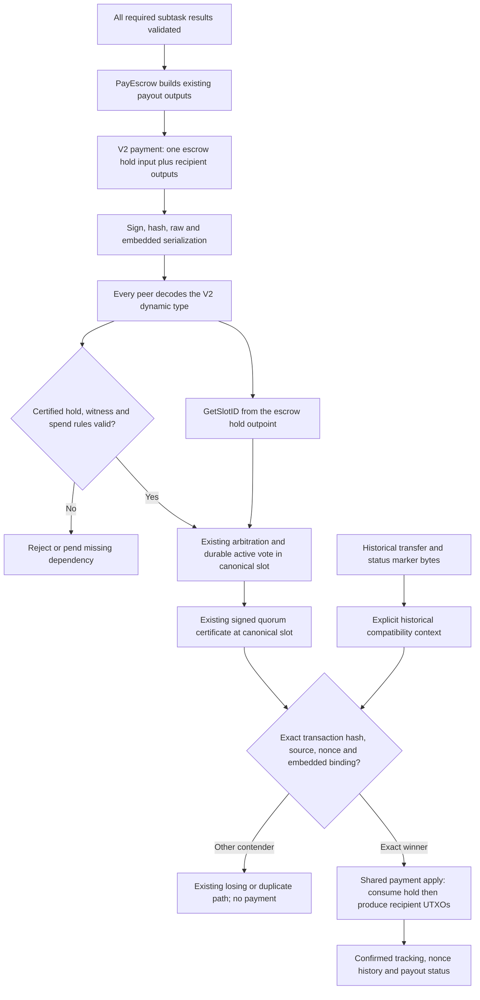

# Phase 21.1: Escrow Payout Slot Identity & Double-Payout Prevention - Research

**Researched:** 2026-11-20
**Domain:** C++17 transaction wire contracts, escrow UTXO payment and canonical consensus identity
**Confidence:** HIGH for source integration; MEDIUM overall because the historical-finality cutover boundary needs an explicit decision.
**Source baseline:** local HEAD `59db81809`; no implementation, build, suites, branch changes, or commits performed. [VERIFIED: git rev-parse; task authorization]

<user_constraints>
## User Constraints (from CONTEXT.md)

The following decisions and deferred work are copied verbatim from the phase context. They supersede the original broad incident suggestions. [VERIFIED: 21.1-CONTEXT.md]

### Locked Decisions

## Implementation Decisions

### Primary fix: follow Mint
- **D-01:** Two different peers attempting to pay the same job escrow must get the same Slot ID despite different sender addresses, nonces, proposal envelopes, signatures, and transaction hashes. Different job escrows must get distinct slots.
- **D-02:** Use the existing transaction-specific Slot ID mechanism, like MintTransactionV2::GetSlotID(), on a dedicated EscrowReleaseTransactionV2. Derive the escrow payout slot from stable, verifiable escrow/job identity; the escrow transaction hash and spent output index are the concrete existing facts to investigate. Exact canonical encoding remains a planning detail; do not implement the fix as another escrow special case inside ordinary TransferTransaction.
- **D-03:** Reconstruct the same slot from serialized/embedded transactions on every peer. Do not use an ephemeral local-only override, an unverified claimed job ID, or mutable payout contents that let a competitor evade the shared slot.
- **D-04:** Reuse the current consensus slot arbitration, active-vote persistence, certificate storage/lookup, and duplicate transaction/certificate behavior. Keep exact certificate-to-transaction binding: sharing a slot must not let the losing payout use the winner's certificate to confirm.
- **D-05:** Check the existing end-to-end path for sender/nonce assumptions that bypass the corrected identity. Make only the corresponding integration fixes needed for escrow payouts. Do not presume changing one return value is sufficient without tracing and testing the actual payout proposal/certificate/application path.

### Existing behavior to preserve
- **D-06:** One escrow funds one job; one final settlement covers all entitled recipients after every required subtask has returned its result.
- **D-07:** Each subtask is processed by one peer through the existing locking, expiration, and takeover mechanism. Preserve that mechanism; do not introduce replicated work or design a replacement assignment policy.
- **D-08:** Any processor with the complete validated results may submit the payout. Do not introduce a designated settlement processor or submitter allowlist. Existing result/payout checks remain; redesigning their authority model is outside this focused fix.
- **D-09:** Handle duplicate certificates as existing transactions do. Do not invent escrow quarantine, node-wide payout pauses, a separate settlement-finality registry, or a new recovery policy.
- **D-10:** Use a coordinated validator upgrade, with all validators fixed before activation. Preserve legitimate historical replay and define any necessary pending-work/cutover handling during planning. No deployment or database reset is authorized.

### Scope control and planner discretion
- **D-11:** Do not make general cross-slot all-input vote reservations, new processor-assignment authorization, a new permanent-conflict journal, or validator-weight changes mandatory work for this phase. These came from the preliminary assessment, not the user's clarified fix.
- **D-12:** Research/planning owns canonical encoding, correct dedicated-type integration, regression layout, and coordinated activation details. If a separate defect blocks this targeted fix, document concrete evidence and its dependency rather than silently broadening the phase.

### Dedicated escrow-release transaction (user refinement)
- **D-13:** Implement EscrowReleaseTransactionV2 as a dedicated final payment transaction with transfer-of-funds semantics: consume the escrow hold and create the payout UTXOs, rather than merely record/check that another transfer completed. V2 owns its GetSlotID() override, versioned serialized/embedded representation, deserializer, signing/hash behavior, validation dispatch, apply/revert handling, topics, and necessary payout/status integration. Reuse established UTXO application and payout-output construction; do not duplicate the consensus framework.
- **D-14:** Ordinary transfers use normal input ownership rules. Move the escrow-specific spending rule out of the generic delegated-escrow exception and into explicit escrow-release validation. A release type tag alone must not authorize arbitrary non-owned inputs: bind the claimed escrow to the actual consumed escrow hold/outpoint and retain existing signature, spend-state, amount/token, and payout checks. This does not restrict submission to a designated processor or introduce Phase 26's broader authority redesign.
- **D-15:** PayEscrow must create the V2 release payment directly; do not emit an ordinary transfer plus a release-status marker as the payment implementation. The existing EscrowTransaction continues to represent escrow holds, TransferTransaction ordinary transfers, and the old release/status representation its historical meaning. Existing Mint identity and exact transaction-certificate binding stay intact.
- **D-16:** The user identified EscrowReleaseTx and the existing escrow_release scaffolding as an older payout-processed/status version. Source currently maps escrow-release deserialization to EscrowTransaction::DeSerializeByteVector and lacks a corresponding parser-table handler; inspect this as legacy behavior, not the V2 contract. Give V2 an explicit version/type and appropriate wire/embedded dispatch while preserving legacy protobuf fields/tags and interpretation; do not silently repurpose the old escrow_release oneof tag 7. Exact V2 wire names/tags and compatibility handling are planning details.
- **D-17:** Tests must prove cross-peer canonical release slots, release roundtrip/embedded reconstruction and correct dynamic type, winner-only certification/application, ordinary-transfer rejection of the removed escrow bypass after activation, invalid claimed/non-escrow release input rejection, and valid release payout contents. Plan historical legacy-transfer payout replay and pending-work cutover explicitly; removing the active bypass must not silently erase or invalidate legitimate old history.
- **D-18:** Prove V2 performs the payment itself: the escrow input is consumed and recipient UTXOs/balances reflect the existing payout distribution exactly once. Keep old release/status bytes distinguishable from V2 through serialization, dispatch, history, and replay. A successful status check or marker alone is not a completed V2 payment.


### the agent's Discretion

The context has no separate discretion section; D-12 above delegates canonical encoding, dedicated-type integration, regression layout and coordinated activation details to research/planning. [VERIFIED: 21.1-CONTEXT.md:D-12]

### Deferred Ideas (OUT OF SCOPE)

## Deferred Work

- Broader input-outpoint reservation protocols and new certificate retry/recovery frameworks are not mandatory deliverables for this phase.
- Existing Phase 26 MINT-01/GRID authorization and verification work remains separately scoped; no completion is claimed here.
- Genesis weight concentration, second-genesis registry membership, and the later unexplained voter stall remain separate investigations.

### Reviewed Todos (not folded)
The user approved keeping these separate:
- `.planning/todos/pending/bridge-race-not-all-11-mint-within-window.md` — bridge mint timing/convergence.
- `.planning/todos/pending/bridge-startup-wiring-mock-rpc.md` — bridge startup/RPC wiring.
- `.planning/todos/pending/nodeconsensustest-registry-catchup-flake.md` — registry catch-up timing.

</user_constraints>

<phase_requirements>
## Phase Requirements

| ID | Description | Research Support |
|----|-------------|------------------|
| PAYSAFE-01 | A dedicated EscrowReleaseTransactionV2 gives two different peers proposing payout for the same job escrow the same transaction Slot ID, independent of sender, nonce, signatures, or transaction hash, using the transaction-specific identity pattern already used by Mint; different escrows remain distinct. | Canonical sole-hold outpoint identity, raw/embedded reconstruction, consensus key equality. [VERIFIED: .planning/REQUIREMENTS.md:34] |
| PAYSAFE-02 | PayEscrow creates the dedicated V2 payment, which consumes the escrow hold and creates recipient payout UTXOs using existing transfer-of-funds semantics and payout distribution. V2 has explicit version/type, raw/embedded serialization, deserializer and validation dispatch, apply/revert handling, and payout/status integration; it is not the old release version that essentially checked payout completion. Preserve legacy release fields/tags/meaning and plan distinct V2 dispatch. Its identity reaches existing consensus/certificate machinery; replace the generic transfer escrow-spend exception with release-specific validation and plan legacy history/pending-work compatibility under the coordinated upgrade. | Distinct V2 wire/lifecycle and typed validation; preserved payout helper; explicit legacy/cutover paths. [VERIFIED: .planning/REQUIREMENTS.md:35] |
| PAYSAFE-03 | Same-slot competing escrow payouts use existing exact certificate-to-transaction binding: only the transaction actually certified may confirm, and another peer's competing transaction cannot reuse its certificate merely because the slot matches. Any processor may submit the complete validated payout; existing payout contents and subtask-locking behavior remain unchanged. | Unchanged exact certificate binding; cross-peer winner-only application regressions. [VERIFIED: .planning/REQUIREMENTS.md:36] |
| PAYSAFE-04 | Same-job payout competitors use the existing generic duplicate transaction/certificate handling, including necessary integration fixes for sender/nonce assumptions; duplicate arrival, replay, and restart cannot produce a second payout effect. No separate settlement registry, quarantine policy, or new general input-lock/recovery protocol is required by this phase. | Canonical conflict recognition plus existing certificate and UTXO replay lifecycle. [VERIFIED: .planning/REQUIREMENTS.md:37] |
| PAYSAFE-05 | Regressions mirror MintSlotIgnoresProposalEnvelope and SharedMintSlotConfirmsOnlyTheCertifiedTransaction for dedicated escrow-release payouts: different peers/nonces/hashes for one escrow share slots, different escrows do not collide, and the existing winner/duplicate path pays at most once across replay/restart/sync. Cover release raw/embedded roundtrip, correct type dispatch, ordinary-transfer rejection of the escrow bypass after activation, invalid release input rejection, valid payout contents, and legacy history/cutover behavior. Retain Mint/transfer regressions and use incident scenarios A-E as relevant validation inputs; weight-policy and broader authorization work remain separate. | Registered CMake/CTest targets, adversarial/compatibility pairs and multi-node fault matrix. [VERIFIED: .planning/REQUIREMENTS.md:38] |
</phase_requirements>

## Summary

Use a new `EscrowReleaseTransactionV2` as the payment, with canonical identity derived from its sole consumed escrow-hold outpoint. The present `PayEscrow` constructs a transfer spending output zero; the transfer inherits `source:nonce` identity. Mint already reconstructs a transaction-specific key through the embedded transaction slot handler, so the consensus framework can be reused. [VERIFIED: src/transaction/TransactionManager.cpp:1306; src/account/GeniusTransaction.hpp:290; src/account/MintTransactionV2.cpp:212; src/transaction/TransactionConsensusHandler.cpp:34]

The implementation needs more than a new slot return value: raw and embedded dispatch, parser registration, both ownership-validation paths, payment apply/revert, and cross-peer conflict discovery must recognize V2. Exact transaction-certificate binding is already implemented and must remain unchanged. The existing legacy release was a separate status marker accompanying a transfer, proven by locally available historical source; it must never become the V2 funds-moving record. [VERIFIED: src/transaction/TransactionManager.cpp:115; src/account/UTXOManager.cpp:811; src/account/GeniusInputValidator.cpp:443; src/transaction/TransactionManager.cpp:1872; git tag TestNet-Phase-3.520:src/account/TransactionManager.cpp:606,1443]

**Primary recommendation:** Add `escrow-release-v2` and a fresh embedded tag, preserve legacy decoding/status semantics, reuse the existing UTXO payment lifecycle, and make canonical-slot equality participate in existing conflict handling. Make historical replay eligibility and pending-work inventory an explicit coordinated-rollout checkpoint. Certificates do not expire merely because live proposal/vote processing stops retrying them; do not represent that checkpoint as solved by a TTL. [VERIFIED: 21.1-CONTEXT.md:D-10,D-13..D-18; src/blockchain/Consensus.cpp:3445,2375,1733]

## Architectural Responsibility Map

| Capability | Primary Tier | Secondary Tier | Rationale |
|------------|-------------|----------------|-----------|
| V2 identity, transaction bytes, topics | Account transaction domain | Protobuf boundary | Derived transaction owns `GetSlotID`, serialization and produced UTXOs. [VERIFIED: src/account/MintTransactionV2.hpp; src/account/GeniusTransaction.cpp:123] |
| Payment construction/distribution | Transaction manager domain | Validated processing results | Existing `PayEscrow` and `BuildPayoutOutputs` own this behavior. [VERIFIED: src/transaction/TransactionManager.cpp:1206,1306] |
| Escrow spend eligibility | Account input validation | Certified producer/witness | UTXO state belongs to UTXOManager; producer/certificate checks already live in GeniusInputValidator. [VERIFIED: src/account/UTXOManager.cpp:811; src/account/GeniusInputValidator.cpp:476] |
| Arbitration, votes, certificate finality | Consensus domain | CRDT persistence | Existing canonical slot selects the vote/finality domain. [VERIFIED: src/blockchain/Consensus.cpp:1936,2706,3938] |
| Consume/produce/revert/status | Transaction manager + UTXO storage | Account nonce history | Existing payment parser and generic lifecycle apply effects before confirmed tracking. [VERIFIED: src/transaction/TransactionManager.cpp:2676,3040,5419] |
| Historical-finality cutover | Coordinated network operations | Explicit application compatibility context | There is no activation boundary in the inspected transaction/certificate interfaces; this needs a rollout precondition. [VERIFIED: src/transaction/TransactionConsensusHandler.cpp:143; src/transaction/TransactionManager.cpp:2624; src/blockchain/Consensus.cpp:3445] |

## Project Constraints (from project instructions)

`AGENTS.md`, `.agents/skills` and `.codex/skills` are absent in this checkout; no project skill was loaded. `CLAUDE.md` directs reading AgentDocs, which was done. A knowledge graph is absent. [VERIFIED: filesystem discovery; CLAUDE.md:1; AgentDocs/AGENT_MISTAKES.md; AgentDocs/Architecture.md; AgentDocs/CHECKPOINT.md]

Account for these actionable instructions in plans: [VERIFIED: CLAUDE.md]
- Keep one owning module per domain rule; domain/persistence/transport/build concerns remain separate. Use public contracts and narrow plain-value interfaces; keep headers small and directly included dependencies explicit.
- Search for existing rules before adding one. Share payment behavior through a behavior-preserving refactor before adding the V2 caller. Preserve errors, integer rounding, ordering, ownership, protocol bytes and thread safety. Do not leave a new helper beside old copies.
- Use the smallest abstraction; no speculative frameworks or dependency-cycle workarounds, no business rules in wire/transport adapters. Composition is preferred; the existing transaction polymorphic contract remains the relevant interface.
- C++17 only; repository clang-format/required clang-tidy; GNUS naming; Allman braces; brace controls; initialize variables; `nullptr`; explicit casts; const correctness; scoped enums; no goto/floating equality; named domain constants; `.hpp/.cpp`; Doxygen file/API documentation; root-relative internal includes and angle-bracket external includes; focused functions and standard algorithms.
- RAII and explicit lifetimes; no application raw `new/delete`; avoid exposing mutable internals. Fallible operations use `outcome::result`, not exceptions, ignored errors or misleading success. Assertions are for programmer errors.
- Preserve cross-platform abstraction; no ad hoc OS/compiler branches in normal source. Do not reformat unrelated code, drop existing Doxygen, use guessed APIs/error methods, capture unstable vector element pointers, or create chained string dispatch when a table owns the rule. [VERIFIED: CLAUDE.md; AgentDocs/AGENT_MISTAKES.md]
- Implementation verification includes formatting, required tidy checks, warning-free affected builds and relevant tests; report checks actually run. Build edits require the project code-review gate before a PR.
- Build edits must preserve DLL/dylib/so and per-configuration artifact routing, `find_package(Python3 COMPONENTS Interpreter)`, portable CMake command drivers, absent-submodule guards, inactive default-off options, guarded standalone cross-target dependencies, generated-source producer dependencies and spec-triggered regeneration. [VERIFIED: CLAUDE.md:7]

Research-only instruction: write only this file; do not implement, run suites, change branches or commit. Existing modified `docs` and untracked files were left untouched. [VERIFIED: task authorization; git status --short]

## Standard Stack

### Core

| Component | Version/policy | Purpose | Recommendation |
|-----------|----------------|---------|----------------|
| C++ | C++17 | Transaction/validator implementation | Use existing account/transaction modules. [VERIFIED: CLAUDE.md] |
| Protocol Buffers | Vendored 34.0.0 / libprotoc 34.0; no upgrade | New raw message and embedded oneof member | Extend `SGTransaction.proto` and `Consensus.proto`; regenerate via their CMake targets. [VERIFIED: src/account/CMakeLists.txt:1; src/blockchain/impl/proto/Consensus.proto:77] |
| Existing GeniusTransaction contract | Checkout `59db81809` | Hash/signature/UTXO/topic/slot API | Derive V2 directly, as other explicit transaction types do. [VERIFIED: src/account/GeniusTransaction.hpp; git rev-parse] |
| Existing UTXOManager + CRDT/RocksDB | Checkout-pinned | Spend evidence, output state, restart replay | Reuse existing public consume/produce/rollback contracts. [VERIFIED: src/account/UTXOManager.hpp; src/transaction/TransactionManager.cpp:2676] |
| CMake + GoogleTest + CTest | CMake/CTest 3.31.4; GTest 1.17.0 | Generated contracts and regression targets | Extend registered `addtest` targets; do not install a new framework. [VERIFIED: test/src/account/CMakeLists.txt; test/src/blockchain/CMakeLists.txt] |

### Supporting and alternatives

Use `InputUTXOInfo`/`UTXOTxParameters`, `BuildPayoutOutputs`, `PutProducedUTXOs`, `DeleteProducedUTXOs`, `BuildUTXOTransitionCommitment`, `BuildUTXOWitness` and `CertificateMatchesTransaction`. They already supply the payment data, commitment and exact-binding contracts needed here. [VERIFIED: src/account/UTXOStructs.hpp; src/transaction/TransactionManager.cpp:1206,2644,2673,1872; src/transaction/TransactionConsensusHandler.cpp:940,999]

Do not use ordinary-transfer flags, tag 7 repurposing, a new settlement-finality store, or a new input-reservation protocol as alternatives; the context explicitly selects a dedicated V2 and existing consensus lifecycle. [VERIFIED: 21.1-CONTEXT.md:D-02,D-09,D-11,D-15,D-16]

**Installation:** None proposed. No new external package/version is recommended, so registry/slopcheck installation auditing is not applicable. Keep existing dependency pins. [VERIFIED: source integration map above; .planning/PROJECT.md:Constraints]

## Architecture Patterns

### System architecture diagram

This proposed flow follows the verified entry points and assigns new release rules to their existing owners. [VERIFIED: src/account/GeniusNode.cpp:ProcessingDone; src/transaction/TransactionManager.cpp:1306,2259; src/transaction/TransactionConsensusHandler.cpp:34,333]



### Component responsibilities and minimal edit map

| Contract | Existing owner | Required change |
|----------|----------------|-----------------|
| Dedicated V2 | New `src/account/EscrowReleaseTransactionV2.hpp/.cpp` | Type/path `escrow-release-v2`, UTXO params, GetSlotID, raw/embedded codec, topics; base hash/signature methods. [VERIFIED: src/account/TransferTransaction.hpp; src/account/MintTransactionV2.hpp] |
| Raw message | `src/account/proto/SGTransaction.proto` | Add `EscrowReleaseTxV2` with DAG and UTXO params; do not alter `EscrowReleaseTx` fields 1..6. [VERIFIED: src/account/proto/SGTransaction.proto:138] |
| Embedded wire | `src/blockchain/impl/proto/Consensus.proto` | Recommend `escrow_release_v2 = 10`: 1..9 are assigned, 7 is legacy release. Keep all existing assignments. [VERIFIED: src/blockchain/impl/proto/Consensus.proto:77] |
| Build | `src/account/CMakeLists.txt` | Add new source to `GENIUS_NODE_SOURCES` so production/test object libraries both receive it. Preserve generated-proto dependencies. [VERIFIED: src/account/CMakeLists.txt:65] |
| Raw/embedded dispatch | `TransactionManager::DeSerializeTransaction` / `DeSerializeEmbeddedTransaction` | Register V2 in explicit anchored registration and add its oneof branch; reject null/mismatched types. Faithfully restore legacy status decoding separately. [VERIFIED: src/transaction/TransactionManager.cpp:2344] |
| Parser/well-formed dispatch | `transaction_parsers` | Register V2 apply/revert; a new class alone fails the known-type check. [VERIFIED: src/transaction/TransactionManager.cpp:115; src/transaction/TransactionConsensusHandler.cpp:598] |
| Payout creator | `PayEscrow` | Replace payment transfer creation with V2; retain input signing, existing output builder, transaction enqueue/signature and completion hooks. Do not create a second release marker as V2 payment. [VERIFIED: src/transaction/TransactionManager.cpp:1343] |
| Spend validation | `CheckTransactionTypeRules` → account input validators/UTXO manager | Add a narrow release-specific local route; ordinary validation has no tx context. Move both escrow exceptions into V2 rules. [VERIFIED: src/transaction/TransactionConsensusHandler.cpp:822; src/account/InputValidators.hpp:74; src/account/UTXOManager.cpp:850; src/account/GeniusInputValidator.cpp:443] |
| Funds application | Transfer parser/reverter + generic state machine | Extract shared payment mechanics while preserving existing transfer behavior; V2 supplies validated escrow owner. Use generic effects-before-confirmation lifecycle; no mint bridge marker. [VERIFIED: src/transaction/TransactionManager.cpp:2676,3040,5419] |
| Conflict lookup | `GetConflictingTransactions` and singular equivalent | Recognize equal canonical slots across peers while preserving sender/nonce chain conflicts; use one owning predicate. Do not replace account-chain continuity globally. [VERIFIED: src/transaction/TransactionManager.cpp:5042,5058] |
| Certificate handling | `OnConsensusCertificate` and CRDT ingestion | Preserve exact binding and run existing conflict cleanup for every winner arrival path, including certificate-embedded fallback. Check all tracked contenders, not unordered-map first-match behavior. [VERIFIED: src/transaction/TransactionConsensusHandler.cpp:82,174,198; src/transaction/TransactionManager.cpp:4784] |
| Status | `WaitForEscrowRelease` and GeniusNode wrapper | Recognize V2 by its actual spend; update misleading transfer labels/docs. Preserve historical status-only representation without applying its UTXO params. [VERIFIED: src/transaction/TransactionManager.cpp:3247; git tag TestNet-Phase-3.520:src/account/TransactionManager.cpp:1443,1752] |

Adding a fresh oneof field preserves old assignments; old readers cannot interpret a newly added oneof member as V2. Protocol Buffers explicitly warns against tag reuse. The coordinated upgrade is required for semantic agreement, even when the binary wire change is additive. [CITED: https://protobuf.dev/programming-guides/proto3/; https://protobuf.dev/best-practices/dos-donts/]

### Pattern 1: Canonical identity from the actual consumed outpoint

Recommend `escrow-release-v2:<normalized-hold-hash>:<output-index>`, derived from the single input rather than a redundant claimed job ID. Require exactly one input at the existing lock index zero, a valid parsed Hash256, and a certified actual escrow-hold producer whose output matches the input and escrow-lock owner. Keep input signatures, proposer metadata and all output contents outside the slot. Distinct attempted payouts for the same input must remain competitors even if they alter recipients or amounts. [VERIFIED: src/transaction/TransactionManager.cpp:1343; src/account/UTXOStructs.hpp; src/account/MintTransactionV2.cpp:212; 21.1-CONTEXT.md:D-01..D-03,D-14]

Use the same codec data for raw and embedded serialization. Reject wrong DAG type, malformed hashes/token encodings, missing/extra inputs, wrong index and non-escrow producer before such data can become an eligible payout. Existing deserializers sometimes use unchecked `fromReadableString(...).value()`; do not copy that failure mode into the new decoder. This phase only needs safe V2 decoding, not Phase 22's global parser rewrite. [VERIFIED: src/account/TransferTransaction.cpp:DeSerializeByteVector; src/account/EscrowTransaction.cpp:105; .planning/ROADMAP.md:Phase 22]

### Pattern 2: Explicit escrow validation at both local and witness boundaries

`UTXOManager::VerifyParameters(params,address)` verifies signatures, duplicate inputs, availability/spend state and amount balance, but currently allows any non-owned index-zero output with an escrow-looking owner. It cannot determine a transaction's type from its arguments. `IInputValidator::ValidateUTXOParameters` also lacks the transaction. [VERIFIED: src/account/UTXOManager.cpp:811..881; src/account/InputValidators.hpp:74]

Recommend an explicit typed V2 route from `CheckTransactionTypeRules`, leaving other chain validators' public behavior intact. Validate V2 shape and actual hold/outpoint, then reuse shared signature/state/amount validation with a validated escrow owner distinct from the signer. Do not add an unverified `allow_non_owned` boolean or accept an arbitrary owner supplied by the proposer. The witness route already receives the transaction and must apply the same release rule before enforcing producer output proof and exact producer-certificate binding. [VERIFIED: src/transaction/TransactionConsensusHandler.cpp:822; src/account/GeniusInputValidator.cpp:368,443,476..566]

Remove the ordinary transfer delegated-escrow rule in live local and witness validation. Preserve independent certified-parent transfer delegation; it is a different existing rule and is not escrow payout authorization. [VERIFIED: src/account/GeniusInputValidator.cpp:373..383,443..446; src/transaction/TransactionManager.cpp:5156; 21.1-CONTEXT.md:D-14]

### Pattern 3: Separate settlement identity from transaction identity and account continuity

`GetTransactionCertificate` already loads `GetCertificateBySlot(transaction.GetSlotID())`. `CertificateMatchesTransaction` checks transaction hash validity, certificate subject source, explicit nonce, exact transaction hash, independently decoded embedded hash and matching slot. Keep every one of those checks; equal slots do not authorize sharing a certificate. [VERIFIED: src/transaction/TransactionManager.cpp:1872..1907]

The two conflict scans still compare only source+nonce. Recommend a shared predicate that recognizes equal canonical slots OR the existing same-source/same-nonce chain conflict, excludes identical transaction hashes, and preserves existing generic winner logic. Regression-test a valid certified winner arriving after an uncertified contender: `CheckTransactionValidity` can mark signature-valid local transactions CONFIRMED without certificate finality, while existing certificate cleanup explicitly distinguishes that condition. Do not let a status-only conflict preempt an exact certified winner during ingestion. [VERIFIED: src/transaction/TransactionManager.cpp:5042,5058,3863,4798; src/transaction/TransactionConsensusHandler.cpp:230]

Keep sender/nonce validation for proposer chain integrity, nonce ordering and certificate envelope binding. Two hardcoded predecessor fallbacks use `address:nonce-1`: `GetRegisteredOutgoingPreviousHash` and `EvaluateTransactionReplayProtection`. That does not identify a pruned V2 predecessor's canonical slot. Plan a narrow existing-certificate recovery path: resolve the exact prior transaction by its hash, then load its derived slot; when the transaction value is absent, recover the exact embedded predecessor from existing canonical certificate records with validated key, hash, source and nonce binding. Do not add a second authoritative by-hash finality record. Add a V2-predecessor restart/pruned-value regression, or explicitly prevent V2 value pruning until this path works. [VERIFIED: src/transaction/TransactionManager.cpp:1759..1809; src/transaction/TransactionConsensusHandler.cpp:690,738; src/blockchain/Consensus.cpp:2773; .planning/PROJECT.md:Protocol safety]

The consensus layer already keys arbitration, persisted active votes and certificate writes by `GetSlotKey`. Existing serialized-certificate hash convergence and duplicate processing should remain the policy. A Mint-specific equivocation log helper exists but is diagnostic; copying it is not required for V2 safety. [VERIFIED: src/blockchain/Consensus.cpp:1936,2706,3330,3405,3938]

### Pattern 4: Reuse actual funds movement and distribution

`BuildPayoutOutputs` burns the configured fraction and split dust, divides the remainder among valid results, floors developer cuts, aggregates developers by address/token, and checks total amounts. Peer/developer outputs use result tokens; burn uses the escrow token. Preserve its output order, floors, malformed-metadata handling and token behavior exactly; do not silently require all outputs to carry the escrow token. [VERIFIED: src/transaction/TransactionManager.cpp:1206..1303; src/transaction/TransactionManager.hpp:BuildPayoutOutputs; test/src/account/payout_outputs_test.cpp]

Extract the existing transfer apply/revert mechanics into shared payment helpers: check consumed inputs, accept own idempotent replay via existing produced-output/spender evidence, consume with the payment transaction ID, then create outputs. Reject a different spender before crediting outputs. Revert only effects applied by that payment, delete its outputs and restore its inputs using the correct validated owner. Retain generic `effects_applied` retry and notification behavior. [VERIFIED: src/transaction/TransactionManager.cpp:2676..2774,3040..3059,5419..5473]

`WaitForEscrowRelease` currently treats consumed output zero or a tracked confirmed UTXO spender as completion; its actual scan is type-generic despite transfer-oriented names. A passing status check alone is insufficient acceptance evidence: tests must inspect the hold's spender and recipient UTXO amounts/balances. [VERIFIED: src/transaction/TransactionManager.cpp:3247..3308; 21.1-CONTEXT.md:D-18]

### Pattern 5: Historical status decoding and coordinated cutover

Historical source proves that `TestNet-Phase-3.520` emitted a payment `TransferTransaction` PLUS `EscrowReleaseTransaction`. Its release parser returned topics and logged the original hold; it did not consume or produce UTXOs. The class preserved release amount/address, escrow source and original hold hash. Current alias decoding as `EscrowTransaction` rewrites the type to `escrow-hold` and loses marker fields; it is not faithful compatibility. Restore a dedicated legacy representation/decoder using that historical contract, preserving tag 7 and status-only interpretation. Do not feed legacy UTXO parameters through the V2 payment helper. [VERIFIED: git tag TestNet-Phase-3.520:src/account/TransactionManager.cpp:606..625,1443..1475,1752; git tag TestNet-Phase-3.520:src/account/EscrowReleaseTransaction.cpp; src/transaction/TransactionManager.cpp:2356,2401; src/account/EscrowTransaction.cpp:15,91]

Historical application and live admission currently converge on the same `ChangeTransactionState(CONFIRMED)`/parser API. Exact certificate matching occurs in historical fetch and certificate handlers, but those methods do not pass a validated-certificate/replay context to the parser. Recommendation: thread a narrow internal application context from those verified call sites. Fresh proposal validation always uses normal transfer ownership; historical delegated-transfer payment application must require exact validated certificate evidence and the selected cutover eligibility policy. Transaction timestamps, uncle strings and an externally asserted replay flag are not authority. [VERIFIED: src/transaction/TransactionManager.cpp:2624..2639,2428..2439,5419; src/transaction/TransactionConsensusHandler.cpp:143..154,174..184]

**Executable rollout plan and checkpoint (no deployment in this phase):**
1. Implement and test distinct fresh-admission, legacy status-decoding and certificate-bound historical-application paths. Retain old transfer slot calculation and old bytes/signatures; do not rewrite historic records. [VERIFIED: 21.1-CONTEXT.md:D-10,D-16,D-17; src/account/GeniusTransaction.hpp:290]
2. Prepare a read-only inventory procedure for each validator/store: exact old payout transactions/certificates, escrow outpoints and spender state; active-vote records, pending proposals, certificate-work/retry state, queued local payout transactions and job/results still awaiting payment. Capture registry CID/epoch and build identity. Use this to settle or explicitly classify pending work before any V2 payout for its escrow. [VERIFIED: src/blockchain/Consensus.cpp:1570,1733,3330; src/transaction/TransactionManager.cpp:1396,2060; 21.1-CONTEXT.md:D-10]
3. Plan a coordinated pause in payout submission and upgrade every validator before V2 admission; retain databases and authoritative canonical certificates. Rebuild eligible uncertified local payout intents as V2 from retained complete results, with nonce handling through existing rollback/release/requeue lifecycle. Never mutate a signed old proposal's bytes into V2 or clear vote/finality evidence to force progress. [VERIFIED: 21.1-CONTEXT.md:D-10; src/transaction/TransactionManager.cpp:2282,5500; src/blockchain/Consensus.cpp:1570]
4. **Require an explicit operator decision/checkpoint on the accepted historical-finality boundary before activation.** Inventory/drain is a precondition, not proof that no withheld old certificate exists. Preserve already-existing validated canonical history. Do not introduce a new per-escrow settlement registry or silently choose a historical-certificate cutoff. [VERIFIED: 21.1-CONTEXT.md:D-09,D-10,D-12; src/blockchain/Consensus.cpp:3445,2375]

Concrete options for that checkpoint: activate only after operators can verify the agreed legacy finality/pending inventory and classify every carried-forward escrow; if that evidence cannot be established, keep real-value V2 activation pending while implementation/planning proceeds. If operators require a cryptographically enforced historical membership boundary, its authenticated source and compatibility semantics require an explicit protocol decision; there is no existing fence to reuse here. A finite snapshot/cutoff must not be quietly invented as a new authoritative settlement registry. [VERIFIED: source audit of src/blockchain/Consensus.cpp:3445,2375,4502; 21.1-CONTEXT.md:D-09,D-10,D-12]

**Known limit:** `ValidateCertificate` and `TallyVotes` verify structure/signatures/registry/quorum without current-time expiry. Live proposal timestamp checking and active-vote restore expiry are separate. A withheld pre-upgrade signed certificate may still validate later in its old sender/nonce slot, separate from V2. The new shared V2 slot proves post-upgrade V2 contender exclusivity under existing quorum assumptions; it does not retroactively prove exclusivity of all old certificates. Do not claim convergence across unresolved old/new conflicts from a local consumed-input rejection alone. [VERIFIED: src/blockchain/Consensus.cpp:3445..3544,2375..2485,4502..4539,2819,1733..1751; 21.1-BUG-BRIEF.md:Problem and evidence boundary]

### Anti-patterns to avoid

- A V2 type with no funds movement, or transfer plus marker, fails the chosen contract. [VERIFIED: 21.1-CONTEXT.md:D-13,D-15,D-18]
- A claimed escrow/job identifier independent of actual input lets contenders evade identity; derive identity from the verified input. [VERIFIED: 21.1-CONTEXT.md:D-02,D-03,D-14]
- Fixing only UTXOManager leaves witness rejection; fixing only witness leaves the broad ordinary ownership exception. [VERIFIED: src/account/UTXOManager.cpp:850; src/account/GeniusInputValidator.cpp:443]
- Treating `CONFIRMED` or equal slots as exact certificate authority can promote an uncertified loser. [VERIFIED: src/transaction/TransactionManager.cpp:3863,1872]
- Extending general processor authorization, subtask assignment or result-certification redesign exceeds this phase. Existing lock/expiry/takeover code remains in place. [VERIFIED: 21.1-CONTEXT.md:D-07,D-08,D-11; src/processing/processing_subtask_queue.cpp:37,166]

## Don't Hand-Roll

| Problem | Don't build | Use instead | Reason |
|---------|-------------|-------------|--------|
| Finality or duplicate registry | Escrow-specific winner database | Existing canonical slot certificates and active votes | These already own arbitration and exact finality lookup. [VERIFIED: src/blockchain/Consensus.cpp:1936,2706; src/transaction/TransactionManager.cpp:1900] |
| Payment arithmetic | A second split/burn implementation | `BuildPayoutOutputs` | Preserves existing rounding/token/order behavior. [VERIFIED: src/transaction/TransactionManager.cpp:1206] |
| UTXO payment application | Copied transfer parser with drift | Shared existing payment apply/revert mechanics | Existing replay/spender evidence handles restart and competing spend rejection. [VERIFIED: src/transaction/TransactionManager.cpp:2676,3040] |
| Signature/hash algorithm | Release-only signing scheme | Base full-transaction signing/hash methods | Existing transaction bytes already bind the signed payout. [VERIFIED: src/account/GeniusTransaction.cpp:37..105] |
| Work ownership | New designated payout processor | Existing locks/results and any eligible submitter | User explicitly preserves this behavior. [VERIFIED: 21.1-CONTEXT.md:D-06..D-08] |

## Runtime State Inventory

This is a transaction-type migration with persisted history, so inventory is required even though no deployment or data mutation is authorized. Counts below describe source contracts, not inspected live stores. [VERIFIED: task authorization; 21.1-CONTEXT.md:D-10]

| Category | Items found / inspected boundary | Action required |
|----------|----------------------------------|-----------------|
| Stored data | Raw tx values under network `/bc-*/tx/` paths, UTXO/spender evidence, canonical `/cert/<slot>` records, durable active votes, account nonce history, queued/pending/certificate work. Live counts not recovered. [VERIFIED: src/transaction/TransactionManager.cpp:2294,2676; src/blockchain/Consensus.cpp:1570,2706; src/account/GeniusAccount.cpp:1315] | Preserve history; add codecs/application context; inventory and classify pending old payouts. Rebuild unsigned/unfinalized intents only through existing lifecycle after cutover decision. No wholesale rewrite/reset. |
| Live service config | Coordinated validator versions/registry CIDs matter; inspected code contains no escrow activation epoch/version fence. External deployments were not queried. [VERIFIED: src/blockchain/Consensus.cpp:3445; 21.1-CONTEXT.md:D-10] | Rollout checklist/checkpoint; do not assume an existing toggle. |
| OS-registered state | No service/process rename is part of this phase; OS registrations were not audited and none is required by the proposed source changes. [VERIFIED: 21.1-CONTEXT.md:Phase Boundary] | No OS migration proposed; leave operator registrations alone. |
| Secrets/env vars | No secret or environment variable rename/install is proposed; none is needed by the new transaction contract. Secret values were not read. [VERIFIED: src/account/GeniusTransaction.hpp; 21.1-CONTEXT.md:Phase Boundary] | No secret migration. |
| Build artifacts | Generated `SGTransaction.pb.*`/`Consensus.pb.*` and transaction library/test objects depend on the changed schemas/classes. [VERIFIED: src/account/CMakeLists.txt; src/blockchain/impl/CMakeLists.txt] | Regenerate and rebuild with existing host protoc/toolchain; old binaries require coordinated replacement, not DB reset. |

## Common Pitfalls

| Pitfall | What goes wrong / warning sign | Prevention |
|---------|-------------------------------|------------|
| Lossy legacy alias | Tag 7 decodes as a hold and drops status fields. [VERIFIED: src/transaction/TransactionManager.cpp:2356; src/account/EscrowTransaction.cpp:15] | Faithful legacy representation; fixture from historical class; assert no V2 type/effect. |
| Mutable-slot escape | Changing recipients/nonce changes slot instead of competing. [VERIFIED: 21.1-CONTEXT.md:D-01..D-03] | Slot contains only normalized actual escrow outpoint. |
| Missing static registration | V2 works when directly constructed but not after serialized/embedded recovery. [VERIFIED: src/transaction/TransactionManager.cpp:2344] | Add explicit decoder anchor, raw and oneof tests in a fresh process target. |
| Cached status preempts winner | Uncertified CONFIRMED contender blocks certified ingress. [VERIFIED: src/transaction/TransactionManager.cpp:3863,4798] | Exact winner finality test across both transaction-first and certificate-first arrival. |
| Same-slot loser borrows certificate | Lookup success mistaken for winner identity. [VERIFIED: src/transaction/TransactionManager.cpp:1872] | Preserve full CertificateMatchesTransaction predicate; negative tampered envelope/embedded bytes. |
| Incomplete payment evidence | Status passes with no correct recipient outputs. [VERIFIED: src/transaction/TransactionManager.cpp:3247] | Assert spender, recipient outputs and balances, then replay/restart. |
| Global nonce replacement | Source chain breaks after canonical settlement change. [VERIFIED: src/transaction/TransactionConsensusHandler.cpp:629] | Keep account continuity; narrowly fix certificate recovery for custom-slot predecessor. |
| False TTL grandfathering | Old signed quorum certificate accepted after the claimed cutoff. [VERIFIED: src/blockchain/Consensus.cpp:3445,2375] | Explicit historical boundary decision/checkpoint; no timestamp authority. |
| Fixture validates wrong behavior | Two peers actually use one source or status-only marker. [VERIFIED: test/src/account/transaction_manager_certificate_fallback_test.cpp:916] | Distinct real account keys/signatures/nonces/hashes, same hold, actual V2 funds assertions. |

## Code Examples

### Existing identity reconstruction and exact winner binding

These existing snippets are the contracts to preserve. [VERIFIED: src/transaction/TransactionConsensusHandler.cpp:40..47; src/transaction/TransactionManager.cpp:1886..1897]

```cpp
// Existing slot handler: the decoded dynamic type owns the canonical slot.
auto tx = TransactionManager::DeSerializeEmbeddedTransaction( nonce.value().transaction() );
if ( tx.has_value() )
{
    return tx.value()->GetSlotID();
}

// Existing exact binding remains necessary after a shared-slot lookup.
if ( !transaction.CheckHash() || subject.account_id() != transaction.GetSrcAddress() ||
     nonce_subject.value().nonce() != transaction.GetNonce() ||
     nonce_subject.value().tx_hash() != transaction.GetHash() )
{
    return false;
}
```

### Proposed canonical outpoint encoding

Illustrative new helper body after shape validation; this is a recommendation using existing input/hash APIs, not an existing function. The index constant and type string must have one owning definition. [VERIFIED: src/account/UTXOStructs.hpp; src/account/MintTransactionV2.cpp:212]

```cpp
std::string EscrowPayoutSlot( const InputUTXOInfo &escrow_input )
{
    static constexpr std::string_view kPrefix = "escrow-release-v2:";
    return std::string( kPrefix ) + escrow_input.txid_hash_.toReadableString() + ":" +
           std::to_string( escrow_input.output_idx_ );
}
```

Do not derive the slot by hashing serialized proposal/transaction bytes: those intentionally include proposer-specific data, and protobuf serialization is not a cross-build canonical identity scheme. [VERIFIED: src/account/GeniusTransaction.cpp:37; src/account/GeniusTransaction.hpp:dag_st; CITED: https://protobuf.dev/best-practices/dos-donts/]

## State of the Art

| Existing/old path | Required phase path | Timing / impact |
|------------------|---------------------|-----------------|
| Historic transfer payment plus status marker | Preserve historical meaning; V2 is a single actual payment | Historical tag `TestNet-Phase-3.520` proves the old split. [VERIFIED: git tag TestNet-Phase-3.520:src/account/TransactionManager.cpp:606] |
| Current transfer source:nonce payout slot | Outpoint-derived dedicated V2 slot | Selected for Phase 21.1, not yet implemented. [VERIFIED: 21.1-CONTEXT.md:D-01,D-13] |
| Lossy tag-7 hold decoder alias | Distinct legacy and V2 raw/embedded handling | Keep existing wire numbers; no reinterpretation. [VERIFIED: src/transaction/TransactionManager.cpp:2356; 21.1-CONTEXT.md:D-16] |
| Generic non-owner escrow exception | Typed V2 spend rule; normal transfer ownership for new admission | Historical effects need explicit compatibility context. [VERIFIED: src/account/UTXOManager.cpp:850; 21.1-CONTEXT.md:D-14,D-17] |

## Assumptions Log

No training-only claims are required for the implementation recommendation. Proposed wire names/tag 10, encoding and helper/API boundaries are explicit planning recommendations grounded in source, not claims of existing implementation. The historical-finality boundary is deliberately unresolved below. [VERIFIED: source contracts cited above; 21.1-CONTEXT.md:D-12]

| # | Claim | Section | Risk if wrong |
|---|-------|---------|---------------|
| — | No `[ASSUMED]` factual claims used | — | — |

## Open Questions

The four questions below are **RESOLVED for planning** by the adopted decisions and named task owners. This resolves implementation scope and required gates; it does not establish deployed historical completeness, complete any implementation/test, or supply operator acceptance.

1. **RESOLVED for planning — deployment-time historical-finality boundary.**
   - Known: old certificates use the old transfer slot; validated certificates have no current-time expiry; exact old history must replay and no reset/new settlement registry is authorized. [VERIFIED: src/blockchain/Consensus.cpp:3445,2375; 21.1-CONTEXT.md:D-09,D-10,D-17]
   - Unknown: actual deployed old versions, recovered canonical certificate history and all validators' pending legacy payout inventory; staging certificates and duplicate ledger credit have not been recovered. [VERIFIED: 21.1-BUG-BRIEF.md:Problem and evidence boundary]
   - Adopted disposition and owners: 21.1-07-2 tests the delayed old-certificate/non-expiring-finality limit and pending-intent reconstruction; 21.1-07-3 writes the per-validator historical-finality/pending-work inventory procedure and evidence record with activation_status=pending. The blocking-human checkpoint 21.1-08-2 owns the actual historical-boundary disposition after implementation verification in 21.1-08-1. Exact-certificate historical application remains owned by 21.1-04-3, per D-10/D-17.
   - External prerequisite remains pending: actual deployed evidence and explicit operator acceptance are required before a separately authorized coordinated activation. Missing evidence or an unaccepted boundary keeps checkpoint 21.1-08-2 unresolved and activation pending. Neither fixtures, local drain, timestamps nor proposal/vote TTL prove the absence of a withheld old certificate. No cryptographic fence or operator approval is assumed; a demand for an authenticated retrospective fence requires a separately authorized protocol decision.
2. **RESOLVED for planning — historical codec and fixture coverage.**
   - Known: source for the status marker is locally available in `TestNet-Phase-3.520`, while the current alias is lossy. [VERIFIED: historical source cited above]
   - Adopted decision and owners: 21.1-02-1 preserves legacy fields 1..6/tag 7 and adds V2 tag 10; 21.1-02-2 owns the single raw/embedded V2 codec and canonical outpoint identity. 21.1-02-3 restores the faithful legacy status-marker codec and derives fixed signed byte fixtures with historical source/tag provenance, expected fields and hash/signature behavior from the recovered historical implementation. 21.1-04-1 owns distinct manager dispatch and status-only/no-funds-effect assertions; 21.1-04-3 preserves the distinction between historical Transfer payment effects and marker replay, per D-13/D-16/D-18.
   - Evidence limit: these mandatory fixtures and tests are implementation work, not already verified compatibility. 21.1-07-3 records any accessible deployed historical bytes/certificates and explicitly lists unavailable evidence for 21.1-08-2; generated fixtures or protobuf parsing alone do not prove recovered deployed-history completeness.
3. **RESOLVED for planning — predecessor recovery after transaction pruning.**
   - Known: fallback keys assume `source:nonce`, while canonical payout slots will differ. [VERIFIED: src/transaction/TransactionManager.cpp:1784; src/transaction/TransactionConsensusHandler.cpp:690]
   - Adopted decision and owners: recovery is required scope, not conditional work. 21.1-06-1 adds read-only lookup over existing canonical certificate records; 21.1-06-2 replaces the two predecessor fallback assumptions and verifies exact hash, source, nonce, derived slot/canonical key and certificate-to-transaction binding after pruning/restart. Its ordinary/Mint compatibility twins preserve account-chain nonce rules; 21.1-06-3 covers durable retry/replay/restart payment effects, per D-05/D-09/D-17. No new finality index, recovery framework or pruning prohibition is introduced.
4. **RESOLVED for planning — preserve existing result-entitlement scope.**
   - Known: existing payout construction uses validated processing results and existing output arithmetic; no new designated submitter or Phase 26 authority design is authorized. [VERIFIED: src/account/GeniusNode.cpp:ProcessingDone; src/transaction/TransactionManager.cpp:1206; 21.1-CONTEXT.md:D-08,D-11]
   - Adopted decision and owners: 21.1-04-2 preserves BuildPayoutOutputs, the all-required-results gate, one-peer locking/expiration/takeover and submission by any eligible processor while wiring the direct V2 payment. 21.1-07-1/2 exercise exact recipient distribution, real balances and reconstruction from retained complete validated results; 21.1-08-1 runs the existing processing queue/result/metadata compatibility targets, per D-06/D-07/D-08/D-11/D-18. Broader Phase 26 entitlement/assignment authorization remains outside this phase; neither V2 type validation nor these compatibility checks claims its completion.

## Security Domain

Security enforcement and Nyquist are enabled. This is a native peer/ledger protocol, so ASVS is used as a control taxonomy, not a web-compliance claim. ASVS 5.0.0 changes chapter numbering from older templates. [VERIFIED: .planning/config.json; CITED: https://raw.githubusercontent.com/OWASP/ASVS/v5.0.0/5.0/docs_en/OWASP_Application_Security_Verification_Standard_5.0.0_en.json]

### Applicable ASVS categories

| ASVS 5.0.0 category | Applies | Phase control |
|--------------------|---------|---------------|
| V1 Encoding and Sanitization | Yes | Bounded typed protobuf decoding, checked hash/token parsing, consistent raw/embedded interpretation. |
| V2 Validation and Business Logic | Yes | Actual hold/outpoint, signature, spend-state, amount and payout-content invariants. |
| V6 Authentication | Signature identity only | Existing account and consensus signature verification; no user-login work. |
| V7 Session Management | No web sessions in phase | No session changes. |
| V8 Authorization | Yes | Ordinary ownership restored; narrowly typed escrow rule, exact certified producer/winner binding. |
| V11 Cryptography | Existing primitives | Reuse account signing/hash and consensus verification; no new cryptography. |
| V16 Security Logging and Error Handling | Existing paths | Preserve explicit rejection/pending/error semantics and record cutover evidence. |

Category names are checked against the official pinned ASVS 5.0.0 document; applicability/control assignments are recommendations based on this phase's source boundaries. [CITED: https://raw.githubusercontent.com/OWASP/ASVS/v5.0.0/5.0/docs_en/OWASP_Application_Security_Verification_Standard_5.0.0_en.json; VERIFIED: src/account/GeniusInputValidator.cpp; src/transaction/TransactionConsensusHandler.cpp]

### Known threat patterns

| Threat | STRIDE | Mitigation / required negative |
|--------|--------|--------------------------------|
| Different proposer envelopes evade one payout decision | Tampering / repudiation | Same normalized actual hold outpoint yields one V2 slot. [VERIFIED: 21.1-CONTEXT.md:D-01] |
| Release tag claims someone else's normal UTXO or another hold | Elevation / tampering | Sole input, index zero, actual certified escrow producer, matching lock owner; reject fake uncle/claimed ID. [VERIFIED: src/account/GeniusInputValidator.cpp:443,476; 21.1-CONTEXT.md:D-14] |
| Loser reuses winner certificate or forged claimed hash | Spoofing / tampering | Exact transaction/embedded/hash/source/nonce binding, plus CheckHash. [VERIFIED: src/transaction/TransactionManager.cpp:1872] |
| Duplicate/restart reapplies outputs | Tampering | Existing spender evidence, generic state ordering and idempotent payment replay. [VERIFIED: src/transaction/TransactionManager.cpp:2676,5419] |
| Backdated ordinary transfer invokes old ownership bypass | Elevation | Fresh admission rejects bypass regardless of tx timestamp; historical apply requires verified context and chosen boundary. [VERIFIED: src/account/UTXOManager.cpp:850; src/blockchain/Consensus.cpp:3445] |
| Withheld old certificate races new payment | Tampering / availability | Explicit cutover evidence/checkpoint; document existing-protocol limit, no invented TTL proof. [VERIFIED: src/blockchain/Consensus.cpp:2375,3445] |

Existing quorum assumptions still apply: a malicious quorum can sign conflicting transactions independently of this identity fix. Incident configurations A–E are useful tests with conforming voters; they do not establish safety against a malicious supermajority. [VERIFIED: 21.1-BUG-BRIEF.md:Reported staging weight imbalance; src/blockchain/Consensus.cpp:TallyVotes]

## Environment Availability

These are read-only local probes and configured-build observations; no clean configure/link or test execution was attempted. [VERIFIED: environment audit]

| Dependency | Required by | Available | Version/location | Fallback |
|------------|-------------|-----------|------------------|----------|
| CMake / CTest | Build/gates | Yes | 3.31.4 | — |
| Compiler | C++17 | Yes | Apple clang 16.0.0 | Existing toolchain |
| Protobuf host compiler/runtime | Wire codegen | Yes | 34.0.0 / libprotoc 34.0; `/Users/henriqueklein/gnus/thirdparty/build/OSX/Release/protobuf_host/bin/protoc` | Use imported CMake tool; PATH `protoc` is absent |
| GTest | Existing tests | Yes | Vendored 1.17.0 | — |
| Existing Release build | Incremental validation | Yes | `build/OSX/Release`; Unix Makefiles, Homebrew gmake; testing enabled; x86_64 + arm64 | Use generator-neutral cmake build |
| Ninja | Other build trees | Yes | 1.13.0; this build also has a stale build.ninja | Do not invoke it against this Makefiles cache |
| Context7 | Documentation lookup | No | No MCP tool or `ctx7` CLI found | Official Protobuf/OWASP documentation used |
| Validator network/history | Rollout evidence | Not inspected | Staging evidence remains unrecovered | Explicit pre-activation operator checkpoint |

Version/location entries are verified from local tool output, `build/OSX/Release/CMakeCache.txt` and vendored configurations. No package installation is proposed; the focused build audit identified no missing blocker, but it does not establish a clean build result. [VERIFIED: local environment; build/OSX/Release/CMakeCache.txt; thirdparty protobuf/GTest configuration]

## Validation Architecture

Nyquist is enabled. No suites were run during research; every command below is an execution recommendation, not a passing result. [VERIFIED: .planning/config.json; task authorization]

### Test framework and code generation

| Property | Value |
|----------|-------|
| Framework | Vendored GoogleTest 1.17.0 / CTest 3.31.4. [VERIFIED: vendored config; local environment] |
| Config | `test/src/account/CMakeLists.txt`, `test/src/blockchain/CMakeLists.txt`, `cmake/functions.cmake`. [VERIFIED: codebase] |
| Quick existing command | `ctest --test-dir build/OSX/Release -R '^(consensus_slot_key_test|payout_outputs_test)$' --output-on-failure` |
| Full suite command | `ctest --test-dir build/OSX/Release --output-on-failure -j1` |
| New focused target | Proposed `escrow_release_v2_test` in account tests, linked like adjacent transaction-manager fixtures. |
| Runtime assurance | Existing certificate tests can wait 10 seconds per case; quick-suite wall time has not been measured. Use focused GTest filters and establish timings during execution; do not label the entire certificate/network target a <30-second gate. [VERIFIED: test/src/account/transaction_manager_certificate_fallback_test.cpp:942] |

`addtest` creates one CTest entry per executable, links GTest/GMock main, writes binaries under `test_bin` and XML under `xunit`, and sets a 600-second timeout. CTest regexes select target names, not GTest case names. `consensus_certificate_test.cpp` exists but its CMake registration is commented out; it is not an existing runnable gate. [VERIFIED: cmake/functions.cmake:8; test/src/blockchain/CMakeLists.txt:16]

`add_proto_library` uses imported `protobuf::protoc`, writes into `<build>/generated`, and depends on source proto and compiler. Rebuild `SGTransactionProto` and `ConsensusProto` rather than editing generated files. Add the V2 source to `GENIUS_NODE_SOURCES`, used by the common production/test object target. Preserve static-link whole-archive/force-load conventions from adjacent test targets when required. [VERIFIED: cmake/functions.cmake:74; src/account/CMakeLists.txt:1,65; src/blockchain/impl/CMakeLists.txt:2; test/src/account/CMakeLists.txt:230]

```sh
cmake --build build/OSX/Release --target SGTransactionProto ConsensusProto -j2
cmake --build build/OSX/Release --target consensus_slot_key_test payout_outputs_test transaction_manager_certificate_fallback_test transaction_manager_pending_lifecycle_test utxo_manager_test processing_payout_metadata_test -j2
ctest --test-dir build/OSX/Release -R '^(consensus_slot_key_test|payout_outputs_test|transaction_manager_certificate_fallback_test|transaction_manager_pending_lifecycle_test|utxo_manager_test|processing_payout_metadata_test)$' --output-on-failure -j1
```

The active cache is Unix Makefiles despite a stale Ninja file. All commands use `cmake --build` to respect that cache. [VERIFIED: build/OSX/Release/CMakeCache.txt]

### Phase requirements → test map

Proposed test names/targets below must be added by execution; existing fixture/target names are verified. A single focused CTest invocation can use `--timeout 30` for a bounded quick gate after separating fast cases from network/restart cases. [VERIFIED: test/src/account/CMakeLists.txt; test/src/blockchain/CMakeLists.txt; local CTest version]

| Req ID | Behavior and meaningful negative | Test type | Automated command | File exists? |
|--------|----------------------------------|-----------|-------------------|--------------|
| PAYSAFE-01 | Two real peers/signatures, different nonces/hashes, same hold → equal object/reconstructed consensus/certificate slots; different hold hashes → different slots; altered payout contents cannot change slot. | Unit | `ctest --test-dir build/OSX/Release -R '^consensus_slot_key_test$' --output-on-failure --timeout 30` | Yes; extend `test/src/blockchain/consensus_slot_key_test.cpp` |
| PAYSAFE-02 | Raw/embedded V2 roundtrip gives correct dynamic type, type/version, bytes/hash/signature/slot, inputs and outputs; legacy tag7 stays status-only; V2 consumes hold and creates exact payout UTXOs; revert restores only its effects. | Unit + integration | `ctest --test-dir build/OSX/Release -R '^escrow_release_v2_test$' --output-on-failure --timeout 30` | No — Wave 0 target/file |
| PAYSAFE-03 | Shared slot certificate confirms only the exact winner, with distinct proposer keys; forged hash/embedded outputs/envelope, borrowed winner certificate and tracked loser cannot gain confirmation. | Integration | `build/OSX/Release/test_bin/transaction_manager_certificate_fallback_test --gtest_filter=CertificateFallbackTest.SharedEscrowReleaseSlotConfirmsOnlyTheCertifiedTransaction` | Fixture exists; case proposed |
| PAYSAFE-04 | Duplicate, certificate-first, transaction-first, concurrent redelivery, manager restart and pending certificate replay pay once; same-slot local uncertified CONFIRMED entry cannot defeat certified winner. | Integration/restart | `ctest --test-dir build/OSX/Release -R '^(transaction_manager_certificate_fallback_test|transaction_manager_pending_lifecycle_test)$' --output-on-failure -j1` | Both files exist; extend |
| PAYSAFE-05 | Transfer escrow bypass rejected in local AND witness paths; valid ordinary transfer remains accepted; fake hold/uncle, wrong index, extra/non-escrow/consumed input, bad signatures, malformed hash/token, duplicate input and output inflation rejected. Missing producer/certificate remains pending, not permanent invalid. | Unit + integration | `ctest --test-dir build/OSX/Release -R '^(escrow_release_v2_test|utxo_manager_test|payout_outputs_test|processing_payout_metadata_test)$' --output-on-failure -j1` | V2 new; others exist |
| PAYSAFE-05 | Legacy transfer payment and status bytes replay only through chosen compatibility context; fresh/backdated legacy bypass denied; queued old work follows explicit cutover policy; V2 predecessor resolves after restart/missing transaction value. | Integration/compatibility | Add focused V2/previous-hash cases to `transaction_manager_pending_lifecycle_test` and `transaction_manager_certificate_fallback_test`; use executable GTest filters for per-task gates | Fixtures exist; cases proposed |
| PAYSAFE-04/05 | Competing cross-peer V2 payouts survive delayed delivery/restart/catch-up with one accepted V2 slot decision and exact once ledger effects. | Real multi-node | Network battery command below | Harness exists; escrow cases proposed |
| PAYSAFE-05 | Actual rollout legacy-finality/pending inventory and approved historical boundary | Manual/operator checkpoint | No honest automated substitute for unrecovered deployed history; offline inventory procedure/fixtures must be tested | Missing deployment evidence; checkpoint |

Test-specific protocol assertions are recommendations derived from requirements and verified fixture APIs, not claims that those tests already pass. [VERIFIED: .planning/REQUIREMENTS.md:34..38; test sources cited below]

### Fixtures and sampling

- `ConsensusSlotKeyTest` installs embedded deserialization → virtual `GetSlotID`; extend `MintSlotIgnoresProposalEnvelope` without changing Mint expectations. Its fake envelope helpers suffice for identity only, not signed payout application. [VERIFIED: test/src/blockchain/consensus_slot_key_test.cpp:129,194]
- `CertificateFallbackTest : test::CRDTFixture` supplies `BuildSignedCertificate`, `PersistCertificateAtSlot`, `FetchAndProcess` and real registry/store wiring. Existing `SharedMintSlotConfirmsOnlyTheCertifiedTransaction` varies nonce under one address; release coverage must also vary source keys. Preserve exact winner binding, then assert actual hold spender and all recipient UTXOs. [VERIFIED: test/src/account/transaction_manager_certificate_fallback_test.cpp:418,916]
- Reuse `CertificateFirstRejectsTrackedSameSlotLoser`, `NewLoadsUtxosBeforeReplayingPendingCertificates` and `CertificateFirstUtxoStoreFailureRetriesFromDurableState` for arrival/restart/failure coverage. [VERIFIED: test/src/account/transaction_manager_certificate_fallback_test.cpp:1055,1178,1432]
- `TransactionManagerRecoveryTest`/`TransactionManagerPreviousHashTest`/`TransactionDeletionRecoveryTest` cover deletion/recovery, `TransferAndEscrowDeletionRestoresConsumedInputs`, `NonMintConfirmAppliesEffectsBeforeConfirmRecord` and `ConflictingSpendOfConsumedInputIsRejected`. [VERIFIED: test/src/account/transaction_manager_pending_lifecycle_test.cpp:139,644,788,906]
- UTXO tests already cover exact escrow owner lookup, consumed persistence and spent-evidence reload; payout tests protect arithmetic/token/developer metadata behavior. Extend these boundaries rather than building a parallel ledger fake. [VERIFIED: test/src/account/utxo_manager_test.cpp:489,685,816; test/src/account/payout_outputs_test.cpp:11]
- Per task: build touched targets and run focused fast identity/codec/validation cases. Per wave: the focused CTest regression set above. Phase gate: focused set plus relevant real multi-node battery and full available suite, with failures/missing gates reported. Do not spend the per-task loop on the full 300-second network battery. [VERIFIED: test/src/blockchain/CMakeLists.txt:multi-node target timeouts; recommended sampling]

### Real multi-node validation and incident matrix

`FinalityFaultNetwork` in `multi_node_finality_fault_test.cpp` supplies real pubsub/CRDT/store plumbing, `RestartPeer` and `RestartAndReconnect`. Existing Mint contention, passive-recipient, durable-boundary restart and publisher-loss tests are the closest precedent; they do not prove release safety without new escrow cases. Use CTest so the process-ownership runner, resource lock and serial-port protections stay active. The battery registers on macOS with CMake ≥3.29, which this machine satisfies. [VERIFIED: test/src/blockchain/multi_node_finality_fault_test.cpp:944,984,1304,1411,1610,1857; test/src/blockchain/CMakeLists.txt]

```sh
cmake --build build/OSX/Release --target multi_node_finality_fault_test multi_node_finality_fault_compatibility_smoke_test -j2
ctest --test-dir build/OSX/Release -R '^(multi_node_finality_fault_test|multi_node_finality_fault_compatibility_smoke_test|multi_node_finality_fault_process_ownership_test)$' --output-on-failure -j1
```

Map incident A/B to configured genesis memberships/weights, C to four equal conforming voters, D to delayed/reordered delivery/partition, and E to restart/catch-up. Capture exact transaction bytes/hashes/slots/outpoints, registry CID/epoch/membership/quorum, certificate verdict and per-node application/balances. Assert certificate exclusivity separately from ledger at-most-once. Record lack of quorum as a permitted progress limit during partition. Staging actual-loss claims remain unverified. Do not import the brief's superseded all-input reservations or processor allowlist into these tests. [VERIFIED: 21.1-BUG-BRIEF.md:Reproduction and acceptance matrix; 21.1-CONTEXT.md:Phase Boundary,D-11]

### Wave 0 gaps

- [ ] New `test/src/account/escrow_release_v2_test.cpp` + `addtest` registration/linkage; separate fast codec/shape cases from slow integration cases.
- [ ] Distinct-key cross-peer release slot and exact-winner certificate fixture helpers; reuse existing account/registry/store fixtures.
- [ ] Fixed legacy status bytes from `TestNet-Phase-3.520` and historic transfer-payout replay fixture; no-UTXO-effect assertion for old marker.
- [ ] Release payment apply/revert/retry/restart assertions using the real payout output builder and persisted spender evidence.
- [ ] Local and witness transfer-bypass negatives, certified hold/outpoint/type binding, malformed serialized data tests.
- [ ] Narrow predecessor/canonical-certificate recovery regression and explicit historical compatibility context tests.
- [ ] Escrow cases in the existing real-network harness; documented operator rollout checkpoint and inventory procedure.
- [ ] Measure focused-gate runtime, record baseline/fixed build IDs and make newly planned commands runnable. No framework installation needed. [VERIFIED: existing test/build infrastructure above; requirements mapping]

## Sources

### Primary (HIGH confidence)

- Phase scope: `21.1-CONTEXT.md` (D-01..D-18), latest `21.1-BUG-BRIEF.md` clarifications, `.planning/REQUIREMENTS.md:34..38`, `.planning/ROADMAP.md:Phase 21.1`, `.planning/PROJECT.md` and `.planning/STATE.md`. STATE's older v1.2 position is not the phase scope authority. [VERIFIED: files read]
- Transaction contracts: `src/account/{GeniusTransaction,TransferTransaction,MintTransactionV2,EscrowTransaction}.{hpp,cpp}`, `UTXOStructs.hpp`, `UTXOManager.cpp` and `GeniusInputValidator.cpp`. [VERIFIED: codebase]
- Lifecycle/identity: `src/transaction/TransactionManager.{hpp,cpp}`, `TransactionConsensusHandler.cpp` and `src/blockchain/Consensus.{hpp,cpp}`. [VERIFIED: codebase]
- Historical status semantics: local `git show TestNet-Phase-3.520:src/account/EscrowReleaseTransaction.cpp` and `...:src/account/TransactionManager.cpp` (transfer + marker at 606; status-only parser 1443; status wait 1752). [VERIFIED: local git objects]
- Build/test evidence: `src/account/CMakeLists.txt`, `src/blockchain/impl/CMakeLists.txt`, `cmake/functions.cmake`, both relevant test CMake files and fixtures named above; local cache/tool versions. [VERIFIED: codebase/environment]
- [Protobuf proto3 guide](https://protobuf.dev/programming-guides/proto3/) and [best practices](https://protobuf.dev/best-practices/dos-donts/): field/oneof evolution and tag preservation, official current pages checked 2026-11-20. [CITED: protobuf.dev]
- [OWASP ASVS 5.0.0 pinned document](https://raw.githubusercontent.com/OWASP/ASVS/v5.0.0/5.0/docs_en/OWASP_Application_Security_Verification_Standard_5.0.0_en.json): category names/scope; applicability mapped to this native protocol. [CITED: official OWASP/ASVS v5.0.0]

### Secondary / tertiary

None needed. No community package discovery, new dependency recommendation or training-only compliance assertion was used. Context7 was unavailable; official documentation was the fallback. [VERIFIED: tool/CLI discovery; source list above]

## Metadata

| Area | Confidence | Reason |
|------|------------|--------|
| Standard stack/build | HIGH | Existing targets, generator/tool versions and generated-source routing inspected. [VERIFIED: build audit] |
| Transaction/identity architecture | HIGH | Complete creation → codec → embedded slot → exact certificate → payment lifecycle traced. [VERIFIED: source contracts above] |
| Legacy status semantics | HIGH | Historical class, payment pair and no-UTXO-effect parser recovered from local tag. [VERIFIED: TestNet-Phase-3.520] |
| Pitfalls / test design | HIGH | Two owner exceptions, source/nonce scans and real fixtures verified; proposed tests not executed. [VERIFIED: source/test audit] |
| Deployed legacy cutover | MEDIUM / unresolved activation precondition | No existing authenticated fence; actual validators/history/pending evidence not recovered. [VERIFIED: source audit; BUG-BRIEF] |

**Research date:** 2026-11-20. **Revalidate:** before execution if HEAD/toolchain changes, and at the coordinated rollout checkpoint for deployed legacy evidence. No test/build pass or deployment safety approval is claimed. [VERIFIED: task scope; local HEAD/tool inspection]

